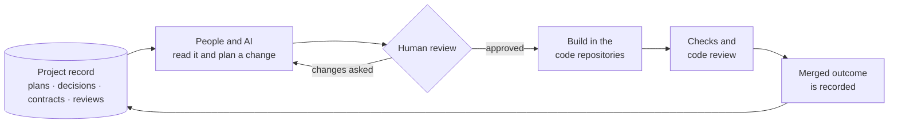
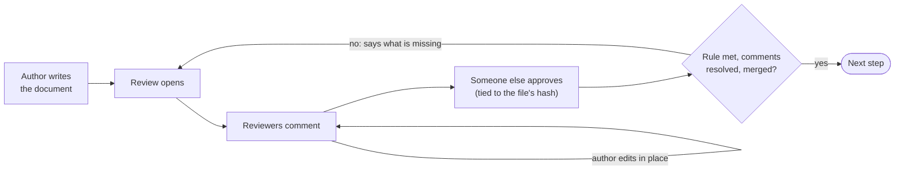

# Yadflow, explained

A complete guide to yadflow for everyone: people who write code and people who do not.

It covers what yadflow is, why it exists, how each part works, and how to fit it to the way your team
works. Every topic has two layers:

- **What and why (for everyone).** Plain words, an everyday comparison where it helps, and the running
  example.
- **How it works (for technical readers).** The files, commands, flags and rules.

Most topics also end with **Try it**: a few commands or instructions you can run yourself.

> This file describes yadflow **4.10.0**. When it and the reference docs disagree, the reference docs
> win: [`docs/CLI.md`](CLI.md) (every command), [`docs/GATES.md`](GATES.md) (every CI check) and
> [`docs/SKILLS.md`](SKILLS.md) (every skill).

<!-- explainer:begin id=how-to-read audience=everyone -->
## 0. How to read this file

> **In one line:** start with sections 1 to 3, then follow the path for what you do.

You do not need to read it all. Sections 1 to 3 give the whole picture in about ten minutes. After
that, pick the path that matches your work:

| You mostly… | Read these sections |
| --- | --- |
| Decide what to build (product manager, founder, business owner) | 1, 2, 3, 4, 6, 11, 22 |
| Design screens or the user experience | 1, 2, 4, 6, 16, 17 |
| Design systems (architect, tech lead) | 1–7, 9, 11 |
| Write code (engineer) | 1–3, 8, 9, 10, 12, 13, 18 |
| Test the product (QA, test engineer) | 1–4, 8, 9, 11 |
| Lead a team or run the setup | 1–3, 6, 10, 12, 20, 21, 22, 23 |
| Want to teach yadflow to others | All of it, then section 25 |

The **Glossary** (section 24) explains every special word in one or two lines. Each word is also
explained the first time it appears.
<!-- explainer:end id=how-to-read -->

---

<!-- explainer:begin id=sixty-seconds audience=everyone -->
## 1. Yadflow in 60 seconds

> **In one line:** yadflow keeps a shared, checked record of what your team decided and why, so people
> and AI assistants build from the same plan.

### What and why (for everyone)

**The problem.** AI assistants now write plans and code very fast. But the reasons behind the work get
lost. A decision is made in a chat, the chat ends, and the next person (or the next AI session) does not
know it was made. Teams spend a lot of time asking "who is doing this?", "was this approved?" and "why
is it built this way?".

**What yadflow does.** It keeps one **project record**: every plan, design, decision, approval and link
to code, saved as readable files. People and AI assistants read that record before they work, and add
to it when they finish. A person approves each important step before work moves on.

Think of it like the logbook on a ship. Everyone on every shift writes in the same book, the captain
signs the important entries, and the next shift reads the book before taking over.

**The name.** *Yad* (**يد**) is Arabic for "hand". The hand is the person who decides. The motto is
*"AI builds. The hand decides."*

**What you get:**

- **Reusable project context.** Plans and decisions live in one place that every session can read.
- **Clear ownership and handoffs.** One command tells each person the single next thing to do.
- **Less repetitive delivery work.** The AI drafts each document; one command makes the commit and opens
  the review.
- **Traceable decisions.** Each approval is tied to the exact text that was approved.
- **Reviews you control.** Every planning step waits for a person.

### How it works (for technical readers)

Yadflow is four things you install:

| Part | What it is |
| --- | --- |
| **The `yad` command-line tool** | A program you run in a terminal (a text window for typing commands). It is written in Node.js and has no dependencies — it needs no other packages to run. It sets up projects, says what to do next, runs reviews and reads the history. Installed with `npm install -g yadflow`. |
| **41 workflow skills** | A **skill** is a set of instructions an AI assistant loads for one task, such as "write the architecture". They run in Claude Code, Codex CLI, Cursor, Gemini CLI, GitHub Copilot, Zencoder and opencode. |
| **Plain files in git** | **Git** is the tool most teams use to save versions of their files. Every plan, decision and approval is a readable file in a git repository (a **repository**, or **repo**, is one project folder tracked by git). There is no database and no server. |
| **Checks in your code repositories** | Small scripts that run on GitHub Actions or GitLab CI — the services that test each change automatically before it is merged. One check, for example, makes every change name the task it belongs to. |

**What yadflow is not:**

- It is **not another coding assistant**. It works with the one you already use.
- It does **not record your chats** with the assistant.
- It does **not guarantee** that a person or an AI reads the record correctly.
- It does **not track deployments** (putting software live) yet. An approved plan says what was agreed;
  the build log says what shipped.
- It has **no server and no account**. Everything is files in your own repositories.
<!-- explainer:end id=sixty-seconds -->

---

<!-- explainer:begin id=big-picture audience=everyone -->
## 2. The big picture

> **In one line:** one repository holds the thinking, your code repositories hold the code, and work
> moves from *Shape* (plan) to *Build* (make).

### What and why (for everyone)

Three words come up everywhere:

- **Product repository** (often just "the Product"). One git repository that holds the project record:
  plans, decisions, approvals and history. It usually holds no product code. Think of it as the team's
  shared notebook.
- **Code repository.** A repository where code lives, such as `backend` (the server) or `mobile` (the
  phone app). Yadflow adds checks to it and links each change back to the plan.
- **Workspace.** The folder on your computer that holds the Product and the code repositories side by
  side.

Work moves in **parts**:

| Part | What happens | Where |
| --- | --- | --- |
| **Shape** | The team plans the work: the goal, the design, the screens, the pieces, the tests. A person approves each step. | The Product |
| **Build** | Each piece is turned into code, checked, and reviewed by an engineer. | Each code repository |
| **Run** | Releasing and operating the software. **Planned, not built yet.** | — |

The record feeds the work, and the work feeds the record:



Not every arrow is automatic. People approve, merge, and ask their assistant for the next step.

### How it works (for technical readers)

The hierarchy of work is **Product → Epic → Story → Task**:

| Level | What it is | ID pattern | Example |
| --- | --- | --- | --- |
| **Product** | The whole product. Its plan is the **Foundation**. | `EP-foundation` | `foundation/` |
| **Epic** | One feature or change. | `EP-<slug>` (a **slug** is a short lowercase name) | `EP-checkout` |
| **Story** | One piece of an epic, tagged with the repos that build it. | `EP-<slug>-S0N` | `EP-checkout-S03` |
| **Task** | One small code change: one branch, one commit. | `<story>-T0N` | `EP-checkout-S01-T01` |

A **feature thread** is a feature plus every later change and fix that builds on it, linked by a
`parent` field. Section 11 explains threads.

The Product finds itself from anywhere: `.yad-workspace.json` in the workspace folder names the Product
folder, so a `yad` command typed inside any code repo the Product lists still finds the Product. A repo
the Product does **not** list never reaches it, because a workspace can be a shared folder such as
`~/Projects` that holds other teams' work.

The full map of every step, check and gate is in
[`docs/diagrams/sdlc-overview.svg`](diagrams/sdlc-overview.svg) (large; open it full size).
<!-- explainer:end id=big-picture -->

---

<!-- explainer:begin id=running-example audience=everyone -->
## 3. The running example: a shop's checkout

> **In one line:** a small shop adds checkout, then fixes a gap in its tests, then changes how orders
> are sorted — and yadflow keeps all three linked.

### What and why (for everyone)

The rest of this guide uses one story. A small shop has:

- a **mobile app** where customers pay for their cart, and
- a **merchant queue** where the shop sees pending orders and marks them done.

Three pieces of work happen, one after the other:

1. **The feature: checkout.** Customers check out in the app and track each order: placed → assigned →
   fulfilled.
2. **A fix.** Nobody ever tested that the merchant queue leaves out orders that are already done. A fix
   adds that test.
3. **A change.** Merchants want the queue sorted by pickup time.

Without yadflow, the fix and the change would each start from a chat or a ticket, and someone would
have to dig to find the original design. With yadflow, the fix and the change are **linked** to the
feature. Anyone can ask "what is true about checkout today?" and get one answer.

### How it works (for technical readers)

The feature and the fix are real records in this repository's [`epics/`](../epics) folder. The change is
added by the terminal recording in the README ([`docs/media/feature-change.gif`](media/feature-change.gif)).

**`EP-checkout`** — the feature (`kind: feature`, `repos: [backend, mobile]`, `status: ready-for-build`):

| Story | What it is | Repos | Status |
| --- | --- | --- | --- |
| S01 | Save the order with its status | backend | shipped |
| S02 | Mobile checkout | mobile | draft |
| S03 | Merchant queue and fulfil | backend + mobile | in-build |
| S04 | Customer order tracking | mobile | draft |
| S05 | Send the `order.fulfilled` event | backend | draft |

Its Shape steps are all done. The architecture review was tagged `contract` and `payments` (higher-risk
areas). The epic review was approved on 2026-06-04; architecture, UI and stories on 2026-06-06.

**`EP-checkout-queue-filter`** — the fix (`kind: defect`, `parent: EP-checkout`):

- The problem: `GET /orders/queue` had no test proving it excludes `fulfilled` and `assigned` orders.
- `inherits: [epic, architecture, contract, ui-design]` — it reuses the parent's approved documents and
  rewrites only the stories and the test cases.
- `escape_stage: test-cases` and `root_cause: missing-negative-test` record *where* the gap slipped
  through and *why*, so the team can learn from it.
- Its `contract-lock.json` is a **pointer lock**: the same fingerprint as the parent's, pointing back to it.

**The change** (in the recording) is started with
`yad epic new <id> --type change --parent EP-checkout --inherits architecture,contract,ui-design`. It
keeps the feature's architecture, contract and UI, replaces the epic text, and retires one old queue
story.

`demo-repos/backend` and `demo-repos/mobile` are small throwaway code repos for trying the Build half.
Only their README is tracked; it has the commands to make them again.
<!-- explainer:end id=running-example -->

---

<!-- explainer:begin id=lifecycle audience=everyone -->
## 4. The lifecycle, step by step

> **In one line:** every epic walks a fixed list of steps; each planning step writes one document and
> then waits for a person to approve it.

### What and why (for everyone)

A **lifecycle** is the list of steps a piece of work goes through, from idea to shipped code. Yadflow's
lifecycle has six **phases** (groups of steps):

| Phase | Part | What happens | Built? |
| --- | --- | --- | --- |
| **Discover** | Shape | Understand the idea and write the epic | Yes |
| **Design** | Shape | Decide how it works (architecture) and how it looks (UI) | Yes |
| **Plan** | Shape | Split it into stories and write the test cases | Yes |
| **Build** | Build | Turn each story into code, check it, review it | Yes |
| **Release** | Run | Release notes, version, deploy record | Planned |
| **Operate** | Run | Defects, feedback, retrospective, improvements | Planned |

For the checkout feature, it goes like this:

1. A product person asks the AI to write the **epic**: "customers check out in the app; merchants see a
   queue". A teammate reviews and approves it.
2. The architect, with the AI, writes the **architecture** and the **contract** — the exact agreement
   between the server and the app, such as "`GET /orders/queue` returns pending orders". Approved.
3. The designer writes the **UI design**. Approved.
4. The product person splits the epic into **stories**. Approved. Now building can start.
5. At the same time, the tester writes the **test cases**. This never holds up building.
6. Engineers **build** each story in each code repo.

Each planning step **stops** until a person approves it. That is the "hand" in yadflow.

### How it works (for technical readers)

Every step is defined once, in the **step catalogue** shipped inside yadflow
(`cli/lifecycle/defaults/2.json`). Each Shape step is an *author* step followed by a *review* gate.

| Step | Phase | Writes | Skill | Gate |
| --- | --- | --- | --- | --- |
| `analysis` (optional route) | Discover | `analysis.md` | `yad-analysis` | analysis review |
| `epic` | Discover | `epic.md` | `yad-epic` | epic review |
| `architecture` | Design | `architecture.md`, `contract.md`, `.sdlc/contract-lock.json` | `yad-architecture` | architecture review (risk tag `contract`) |
| `ui-design` (optional) | Design | `ui-design.md`, `DESIGN.md`, `.sdlc/design-links.json` | `yad-ui` | UI review |
| `stories` | Plan | `stories/EP-<slug>-S0N.md` | `yad-stories` | stories review → **`ready-for-build`** |
| `test-cases` (parallel) | Plan | `test-cases.md`, `.sdlc/test-links.json` | `yad-test-cases` | test-cases review |
| `spec` | Build | `specs/<story>/` in the code repo | `yad-spec` | — |
| `tasks` | Build | tasks of ≤3 files each | `yad-spec` | — |
| `implement` | Build | code on a task branch | `yad-implement` | — |
| `checks` | Build | CI gates, locally then on the PR | `yad-checks` | — |
| `engineer-review` | Build | PR review and merge | `yad-engineer-review` | always a person |

Points to know:

- **`ready-for-build`.** When the stories review passes, the epic reaches `currentStep: ready-for-build`.
  It stays in Build for the rest of its life. Build steps then run **per story, per code repo** — each
  such pair is a **lane**.
- **Test cases run beside Build.** The test-cases review opens at the same moment as Build and never
  blocks it.
- **Each author step opens its own branch** (`<step>/EP-<slug>`) and ends with one clean commit
  (`yad fold`).
- **The Foundation** is the plan for the whole product (purpose, scope, MVP, roadmap, stack, repos,
  risks), written once by `yad-discovery` into `foundation/` and reviewed like any step. It sits
  outside the six phases. It is meant to come before any epic, but it is optional: with none,
  `yad next` offers it as an optional step. When epics go ahead of a Foundation that has not passed its
  review, `yad next` notes it ("reported, not enforced") and never refuses. `yad foundation status` shows each roadmap feature as planned, in-shape, in-build or
  shipped; `yad foundation publish` turns each feature into an issue, with a milestone per phase.
- **The phase is never stored.** It is worked out from the step ID, so it cannot go out of date.
- **Code-aware planning.** When code repos are connected, each author step first reads each repo's
  **code map** (a short summary of the endpoints, events, data models and modules that already exist).
  The architecture checks the contract against real endpoints before locking it. Each document records
  what it read in its `code-context:` frontmatter (the settings block at the top of a Markdown file).

### Try it

```bash
yad epic new EP-checkout          # lay out the steps for a new epic
yad next EP-checkout              # the single next action, with all six phases shown
yad guide EP-checkout             # what this step is for, who does it, can it be skipped
```

Then, in your AI assistant: *"Run the yad-epic skill: customers can check out their cart in the mobile
app, and merchants see a queue of pending orders."*
<!-- explainer:end id=lifecycle -->

---

<!-- explainer:begin id=routes audience=everyone -->
## 5. Routes: not every change needs every step

> **In one line:** pick a short route for small, already-decided work, and the full route for anything
> that changes how systems talk to each other.

### What and why (for everyone)

A dependency update should not need the same ceremony as a payments rewrite. So yadflow has several
**routes** (also called **profiles**): fixed lists of steps for different sizes of work.

| Route | Steps | Use it for |
| --- | --- | --- |
| **classic** | 10: epic, architecture, UI (optional), stories, test cases — each with a review | Most features, and every change, defect and hotfix |
| **analysis-first** | 12: an analysis step, then classic | An idea that needs research before it becomes an epic |
| **chore** | 4: epic, stories | Upkeep somebody already decided on: a dependency bump, moving CI |
| **spike** | 6: analysis, epic, stories | A time-boxed question, where finding the answer *is* the work |
| **foundation** | 2: the Foundation and its review, no Build | The plan for the whole product (once) |
| discovery | old name for foundation | Products made before E75, until `yad migrate --apply` |

**The one rule to remember:** work that changes the shared contract (section 7) belongs on **classic**,
whatever its size. The short routes have no architecture step, so they cannot change the contract.

**The choice is final.** Once an epic's steps are laid out, its route cannot be changed. If a chore
turns out to need a contract change, that change becomes a new epic on classic.

### How it works (for technical readers)

```bash
yad epic new EP-bump-node --type chore --profile chore
yad epic new EP-cache-q --profile spike
```

- `--type` (feature, chore, change, defect, hotfix) and `--profile` are chosen separately.
  `--type chore --profile classic` is valid for big upkeep that does touch the contract.
- The epic records its route in `epics/<epic>/.sdlc/state.json` (`profile` key). `yad doctor` reports
  `profile:disagree` when the steps match a different route, and `step:off-route` when they match none.
- Leaving a step out (an epic with no screens has no UI step) keeps you on the route. A step no route
  has, or two steps in the wrong order, takes you off it.

**Passing over a step.** Three ways, at three levels:

| Command | Meaning | Rules |
| --- | --- | --- |
| `yad skip <epic> <step> --reason "…"` | "This step does not apply." | Only a step the route marks optional (on classic and analysis-first: `ui-design`). Short routes mark none. `yad unskip` puts it back. |
| `yad defer <epic> <step> --reason "…"` | "It applies, just not yet." The review is postponed, not waived. | Same optional-only rule. `yad undefer` works at any time; late, it re-opens the step beside finished work. |
| `yad defer … --debt` | A deferral the team **owes back**. | Reminders on every `yad next`, `yad doctor` and `yad gate status` until the step's review passes. |
| `yad skip <epic> <story> --repo <name> --reason "…"` | One whole Build lane (one story in one repo) needs no change. | Only after the stories review; never for the story's last lane. No single Build step can be skipped. |

**Step states.** Every step is in one of eight states:

| State | Meaning | Does the chain stop here? |
| --- | --- | --- |
| `todo` | Not started | Yes |
| `in_progress` | Being written | Yes |
| `in_review` | Waiting for approval | Yes |
| `blocked` | Stuck, not by choice (`yad unblock` clears it) | Yes |
| `done` | Finished; records how (merge, approved, repair…) | No |
| `skipped` | Marked N/A, with a reason | No |
| `deferred` | Postponed, still owed | No |
| `satisfied` | Inherited from a parent epic | No |

On a Product in **verified** mode (where only CI writes the record, see section 6), skip, defer and
unblock refuse once the epic's record is on the default branch, because only CI may change it there.
<!-- explainer:end id=routes -->

---

<!-- explainer:begin id=review-gates audience=everyone -->
## 6. Review gates and human control

> **In one line:** nothing in planning moves on until a person approves the exact text — and the AI is
> stopped from approving for you.

### What and why (for everyone)

A **review gate** is a stop sign at the end of each planning step. The step moves on only when:

1. **one person** approves it — meant to be someone other than the author (see the note below),
2. every review comment is resolved, and
3. on GitHub or GitLab, the review is merged.

**Approvals are tied to the exact text.** Yadflow saves a fingerprint of the file at the moment it is
approved (a **hash** — a short code computed from the file's contents; change one letter and the code
changes). If anyone edits the file afterwards, the approval no longer counts. Nobody can approve a
draft and then quietly change it.

**There are no roles.** Yadflow keeps no list of who is "the architect" or "the reviewer". Anyone with
access to the repository can approve.

**Who stops authors approving their own work?** The platform, not yadflow. GitHub never lets you approve
your own pull request. GitLab stops it only when the project's approval settings say so. On the local
gate (no platform), an approval by the author is recorded with a warning, not refused.

**Solo or team.** A one-person project does not need a second approver:

| Mode | Approvals counted? | What still decides |
| --- | --- | --- |
| **team** | Yes: one approval | Approval + resolved comments + merge |
| **solo** | No (recorded as `waived: "solo"`) | Your own merge, or `yad gate advance` — that is the human decision |

Yadflow notices when a "solo" project seems to have more than one active person, and suggests switching
to team mode. It never switches for you.

### How it works (for technical readers)

**Three ways to run the gate:**

| Platform | How a review happens |
| --- | --- |
| **GitHub / GitLab, `ledger: local`** | `yad gate open` opens a review pull request (GitHub) or merge request (GitLab) — a **PR/MR**, a proposed change others can comment on and approve. After the merge, `yad gate sync <epic>` copies approvals and comments into the record and moves the step on. |
| **GitHub / GitLab, `ledger: verified`** | The same PR/MR, but nobody runs sync: the Product's CI runs `yad gate ci --merged` at the merge and commits the record itself. Only CI may change the record; a `ledger-guard` check, an agent hook and a git pre-commit hook stop anyone else. |
| **No platform** | Recorded on your machine: `yad gate open …` first, then `yad gate comment … --by <name>`, `yad gate approve … --by <name>`, then `yad gate advance …`, which moves on only if the rule is met and otherwise says what is missing. |

The **ledger** is the record of each epic's steps and reviews: `.sdlc/state.json`, `approvals.json`,
`comments.json` and the `reviews/` folder.

**When a record change must land anyway (verified mode).** In verified mode a git pre-commit hook in each
clone refuses edits to the record. `yad commit --manual --reason "<why>"` (a person only) gets past that
local hook and writes the reason into the commit as a `Ledger-Override:` line. CI's `ledger-guard` still
fails the commit and shows the reason, so someone allowed to bypass the rules must merge it. **Never
require signed commits on the Product's default branch in verified mode:** the CI bot's record commit is
not signed, and would be refused.

**The approval rule in detail:**

- **Base:** 1 approval. Only the base holds the gate. yadflow does not compare the approver with the
  author; the platform does (see above).
- **Risk extra (advice only):** a step tagged `contract` asks for 2 more (so the architecture review
  reports 3), `auth` or `payments` for 1 more. The highest tag counts, never the sum.
- **Capacity cap:** the asked-for count is capped at "active people minus 1", never below 1. It is
  reported, not enforced (enforcing it is parked as E108).
- **Hash binding:** each approval stores `artifactHash`, computed at the approved PR head. The file's
  `status:` line is left out of the hash, so marking a file approved does not break its own approval.
- **Reopening:** `yad gate reopen` takes back a passed step before Build starts. The one exception is
  `test-cases`, which may be reopened while Build runs (the epic stays `ready-for-build`). The old
  approvals are moved into a `reopens[]` list, not deleted. Once Build begins, any other change becomes a
  linked change epic (section 11).
- **Changed since approved.** If a reviewed file changes after its review passed, `yad next`,
  `yad status` and `yad doctor` warn about it. The way out is a fresh review PR.
- **A changed Foundation.** `yad gate reopen` never takes the Foundation. If the Foundation changes after
  its review, `yad foundation publish` refuses, and it and `yad foundation status` print the step that
  clears it for your setup:

  | Setup | What clears it |
  | --- | --- |
  | No GitHub or GitLab | The person runs `yad gate approve EP-foundation foundation/ --by <name>`. |
  | Team mode | A fresh review PR/MR of the Foundation as it stands; its approvals cover it. |
  | Solo mode | The same fresh PR/MR; its merge covers it. `yad gate sync` (local record) or CI at the merge (verified record) adds the merge to the review step's `rereviews` list. The first approval record is kept. |

  A solo merge covers only what that PR merged: a later edit blocks publish again.

**What the AI may never do.** In Claude Code and Cursor, an **agent guard** hook (a small script the
assistant runs before each shell command) refuses four kinds of command:

1. a yad command only a person may run: `gate approve`, `gate comment`, `gate advance`, `gate reopen`,
   `commit --manual`;
2. approving or merging a PR/MR with `gh` or `glab` (the GitHub and GitLab command-line tools);
3. skipping git hooks (`git commit --no-verify` and similar);
4. a force push, which overwrites commits already on the server.

**An honest limit:** the hook reads only the command line, so it catches mistakes, not tricks. In
Codex, which has no hooks, only the written rules apply. And the local gate records the name typed after
`--by`; it cannot prove who typed it. **A team that needs proof of who approved should review on GitHub
or GitLab.**

**Help reviewing.** Two skills and one command make reviews faster and better. None of them blocks a
merge:

- `yad-review-companion` — a 60-second summary ("trailer"), swipeable review cards and a chat grounded
  in the change.
- `yad-pair-review` — walks you through a change one risky part at a time, asks you questions, and keeps
  a private log of how your reviewing improves.
- `yad review nudge` (a command the companion also uses) — reminds an approver who approved without any
  sign of having looked.



### Try it

```bash
yad gate status EP-checkout                    # who approved, what is missing
yad gate open EP-checkout epic.md              # open the review first
yad gate approve EP-checkout epic.md --by sam  # no-platform project; run by the person, never the AI
yad gate advance EP-checkout epic.md
yad mode                                       # shows solo or team
```
<!-- explainer:end id=review-gates -->

---

<!-- explainer:begin id=contract audience=everyone -->
## 7. The shared contract and its lock

> **In one line:** the contract is the written agreement between your systems, and a lock makes sure
> nobody changes it without saying so.

### What and why (for everyone)

When a product has more than one code repo — say a server and a phone app — they must agree on how they
talk: which addresses exist, what data goes in and out, which events are sent. That agreement is the
**contract**. If the server changes it silently, the app breaks.

Yadflow writes the contract down in `contract.md` during the architecture step, and then **locks** it:
it saves a fingerprint of the agreed text. From then on, any code change that touches the contract must
say so out loud, and the contract must be approved and locked again.

In the checkout example, the contract includes `GET /orders/queue` (the merchant's list of pending
orders) and the `order.fulfilled` event. Both the server and the app build against that one text.

### How it works (for technical readers)

- The contract surface sits between `CONTRACT-SURFACE:BEGIN` and `CONTRACT-SURFACE:END` markers in
  `contract.md`.
- `yad-architecture` hashes it (SHA-256) into `epics/<epic>/.sdlc/contract-lock.json`.
- In the code repos, each story's spec **quotes** the locked contract under `specs/<story>/contracts/`;
  it never widens it.
- The **contract-check** CI gate lets a change under `specs/<story>/contracts/` through in one of two
  ways:
  - **It is only a quote.** Each changed slice file holds exactly one
    `<!-- CONTRACT-QUOTE:BEGIN -->` … `<!-- CONTRACT-QUOTE:END -->` block, copying an unbroken run of the
    locked contract's lines, in order. No trailer is needed. `yad-spec` writes slices this way, so a
    normal new spec passes.
  - **It is declared.** A commit carries `Contract-Change: yes`, **and** each changed story's `link.md`
    pins the Product's current contract lock — meaning the contract was changed and locked again first,
    in the Product.
- To compare against the lock, CI must **reach the Product**: a `product-checkout` step clones it, using
  the committed `.sdlc/product-link.json` (written by `yad check --fix --push`) and a
  `YAD_PRODUCT_TOKEN` secret. When the Product cannot be reached, the lock comparison is skipped with a
  note — except on a repo's **first spec**, which then fails.
- A short-route epic (chore, spike) has no lock at all, so a `Contract-Change: yes` commit on one fails —
  when the Product is reachable from the build.
- An inherited architecture gets a **pointer lock**: the same hash as the parent, with
  `inheritedFrom` and a reference to the parent's lock file.
<!-- explainer:end id=contract -->

---

<!-- explainer:begin id=build audience=everyone -->
## 8. Build: from story to merged code

> **In one line:** each story becomes small, checked, reviewed code changes in each repo it names, and
> every change links back to its story.

### What and why (for everyone)

Once the stories are approved, engineers (with their AI assistant) build each story in each code repo
it names. The work is cut into **tasks**, each a small change of at most three files. Small changes are
easier to review and safer to undo.

Every change carries a label naming its task. So months later, anyone can start from a line of code and
walk back to the task, the story, the epic and the approved reasons behind it.

The final say is always a person: an engineer reviews the code and merges it. AI can do a first review
pass, but it only advises.

### How it works (for technical readers)

Inside each code repo the story names:

| # | Step | What happens | Skill / command |
| --- | --- | --- | --- |
| 1 | **Spec** | Writes `specs/<story>/` (spec, plan, tasks) and `link.md` back to the story, using **Spec Kit** (an open-source tool for spec-driven development) when installed. Small work can use a **light spec**: one `spec.md` with marked tasks. | `yad-spec` |
| 2 | **Implement** | One task = one branch = one commit, ≤3 files. If the change would grow beyond the files the task declared, it stops and flags it. | `yad-implement` |
| 3 | **Check** | Runs every CI gate (section 9). `yad run checks` runs them on your machine first, the way CI will. | `yad-checks` |
| 4 | **Ship** | Makes the commit by the conventions and opens the PR/MR with the template filled in and an approval count printed. | `yad ship` (= `yad commit` + `yad open-pr`) |
| 5 | **Engineer review** | An advisory AI pass (CodeRabbit), then a human engineer approves and merges. | `yad-engineer-review` |

**Commit conventions.** A commit message starts with a type (`feat:`, `fix:`, `chore:` …) — the
**Conventional Commits** style — and ends with **trailers**, labelled lines at the bottom:

```text
feat(orders): add pending-orders queue endpoint

Task: EP-checkout-S03-T01
Contract-Change: yes
```

- `Task:` is required (except for `chore`, `ci`, `build` and `test` commits).
- `Contract-Change: yes` only when the contract surface changed.
- An AI `Co-Authored-By:` line is **off by default**; it is added only with `--ai <id>`, from the fixed
  list yadflow ships (claude, copilot, cursor, coderabbit, none). `config.yaml` shows that list,
  but editing it there does not change what `--ai` accepts.
- `yad commit` refuses more than 3 staged files unless you pass `--force`.

**Recording what shipped.** The Product keeps a **build log** (what merged, from which PR):

| Command | Records |
| --- | --- |
| `yad build ship <story> --task <T> --repo <r> --pr <n>` | One task shipped, read from the merged PR |
| `yad build merged … --ship` | Asks the platform whether the PR merged, then records it |
| `yad build done <story>` | The story is fully shipped |
| `yad build sync` | Catches up on every merge at once |
| `yad checkpoint --push` | Commits the machine-written Build files to the Product |
| `yad tidy up` | Folds many small record files back into one (like tidying a drawer) |

Records are written as many small **shard files** (one per entry), so two people shipping different
tasks never collide. `yad tidy up` folds them together later.

**Multi-repo story.** A story tagged `repos: [backend, mobile]` runs these steps in each repo, on its
own, all from the one locked contract.

**Existing code.** Before changing a feature built before yadflow, `yad-backfill` drafts a spec of what
already exists, and a person approves it. If a feature has no epic at all and you need to file a bug,
`yad-stub` makes a minimal parent epic so the fix has something to link to.

**After building.** `yad-scan` checks each finished change and files security findings, technical debt
and suggestions as issues. It never blocks.

### Try it

```bash
cd backend
yad ship --type feat -m "add pending-orders queue endpoint" --task EP-checkout-S03-T01
yad run checks --body pr-body.md      # the CI gates, on your machine
```
<!-- explainer:end id=build -->

---

<!-- explainer:begin id=ci-checks audience=technical -->
## 9. The CI checks

> **In one line:** small scripts in each repository that refuse a change which breaks the rules — no
> task link, a silent contract change, an unsigned commit.

### What and why (for everyone)

Rules on paper get forgotten. So yadflow puts its rules into **checks** that run automatically on every
proposed change. If a check fails, the change cannot be merged (once the repository is set to require
it). The checks are the reason the record can be trusted: they make the links and approvals real, not
just good intentions.

### How it works (for technical readers)

The checks are CI-agnostic bash scripts in `checks/`, run by GitHub Actions or GitLab CI. Full rules,
exemptions and failure messages: [`docs/GATES.md`](GATES.md).

**In code repos:**

| Check | What it enforces |
| --- | --- |
| **spec-link** | Every commit has a `Task:` trailer, and its story has a spec in this repo. |
| **contract-check** | A change to the contract must be declared (`Contract-Change: yes`) and re-locked. |
| **build/test/lint** | The repo's own lint, build and test scripts pass. |
| **lineage-check** | A change, defect or hotfix epic names a real `parent:`. |
| **epic-open** | No new work lands on a **sealed** epic (one whose stories have all shipped). |
| **reconcile-debt** | While a hotfix's debt is open, no other change ships on that thread. |
| **risk-map** | Advice only: prints the suggested approver count from the repo's risk map. |
| **backfill** | Added by hand. A change to an old feature waits until that feature's backfill spec is approved. |

**In every repo (Product and code):**

| Check | What it enforces |
| --- | --- |
| **commit-message** | Conventional Commits subject, trailers in order. |
| **pr-title** | Conventional title; on the Product, `review: <artifact> (EP-<slug>)`. |
| **pr-template** | The PR body uses the template's sections and risk line. |
| **verified-commits** | Every commit carries a signature GitHub or GitLab marks "Verified". Skipped, with a warning, when there is no platform. |

**In the Product only:**

| Check | What it enforces |
| --- | --- |
| **ledger-guard** | In verified mode, only the CI bot may change the review record. |
| **member-check** | A PR may change only its own author's member file. |

**Making them block.** A check only stops a merge when the repository's **branch protection** (the
platform setting that says "these checks must pass before merging") requires it. See
[`docs/branch-protection.md`](branch-protection.md). `yad ci check` reads whether those settings are on
and names each gap. `yad signing check` says whether your commits will be signed and Verified.
<!-- explainer:end id=ci-checks -->

---

<!-- explainer:begin id=automation audience=everyone -->
## 10. Automation, carefully

> **In one line:** the team can let the AI move some Build steps on by itself, can see how well that
> has gone, and can switch everything back to manual with one command.

### What and why (for everyone)

Each step has two **dials** — settings you turn, like a volume knob:

| Dial | Question it answers | Settings |
| --- | --- | --- |
| **driver** (once called *assistance*) | How much does the AI help with this step? | `human`, `pair` (person and AI together), `agent` (the AI does it) |
| **advance** (once called *automation*) | Who moves the step on when it is done? | `human` (a person says go) or `auto` (it moves on by itself) |

The rule is: **automate from the safe end first.** Only Build steps (spec, tasks, implement, checks) can
move on by themselves. Every review gate, and the final engineer review, is **always** a person.

Yadflow keeps a **trust log**: a record of every automated run, and how often a person accepted its
result unchanged. The team looks at it to decide whether to turn a dial up. It is advice only — the team
decides.

If anything goes wrong, the **kill switch** puts every step back to "a person decides", in one command.

### How it works (for technical readers)

```bash
yad dial                                          # every dial, with its trust record as advice
yad dial EP-checkout EP-checkout-S03 --repo backend checks --to auto
yad dial open-pr --to auto                        # the AI may open task PRs without asking
yad kill --reason "flaky test suite, holding all steps"
yad unkill
```

- `yad-run` is the orchestrator: it drives a story's Build loop (spec → tasks → implement → checks) in
  one repo, reading each step's dial. On `auto` it moves on; on `human` it stops for a person. Every run
  is written to `epics/<epic>/.sdlc/trust-log/` as a shard file.
- **It always stops for a person** — whatever the dial says — on any check failure, a change larger than
  the files the task declared, a touch on the contract surface, or an open question only a person can
  answer.
- **"Earning" automation is retired** (E34). It once needed a trust threshold. Now the team sets the dial
  directly, and the trust record is shown beside it as advice.
- A Shape author step set to `auto` is recorded, but nothing acts on it. A review gate set to `auto` is a
  `yad doctor` failure: a gate is never automatic.
- The kill switch is stored in `.sdlc/automation.json` with who, when and why. If that file cannot be
  read, yadflow treats the kill switch as **on**.
- `yad dial open-pr` is the standing approval for the agent to open a task's PR/MR. Without it, the agent
  asks first every time.
<!-- explainer:end id=automation -->

---

<!-- explainer:begin id=threads audience=everyone -->
## 11. Changing shipped work: feature threads

> **In one line:** you never edit an old approved plan; you start a linked change, and yadflow works out
> what is true today.

### What and why (for everyone)

Once a feature ships, its approved documents are history. Editing them would erase the record of what
was agreed. So a change becomes a **new epic linked to the old one**. The chain of a feature and all its
later changes and fixes is a **feature thread**.

Back to the shop: the checkout feature is the start of the thread. The test fix and the sorting change
are both linked to it. Ask yadflow about checkout and it combines them: the original architecture still
applies, the fix added a test, and the change replaced the queue description.

The `yad-change` skill sorts each change into one of four kinds. The kind decides which documents must
be written again:

| Kind of change | Written again | Kept from the parent | Starts at |
| --- | --- | --- | --- |
| **Defect fix** — it does not do what was agreed | stories, test cases | epic, architecture, contract, UI | stories |
| **Behaviour change** — it should do something different, same interfaces | the epic's changed part, stories, tests (+ UI if visible) | architecture, contract (not re-locked) | stories (or UI) |
| **Contract change** — the systems must talk differently | architecture + contract (re-locked), stories, tests | what is untouched | architecture |
| **New capability** — something new | the whole chain | context only | epic |

**Urgent fixes.** A **hotfix** may ship first and do the paperwork after. Yadflow records that as
**reconcile debt**: the thread owes an update to its documents and a regression test (a test that proves
the bug stays fixed). Until it is paid, no other change can ship on that thread.

**Sealed epics.** When every story of an epic has shipped, the epic is **sealed**. New behaviour then
needs a new linked epic. A CI check enforces this.

### How it works (for technical readers)

```bash
yad epic new EP-checkout-pickup-sort --type change --parent EP-checkout \
  --inherits architecture,contract,ui-design
yad thread EP-checkout        # the "current truth" of the thread
yad thread                    # every thread
yad reconcile check           # drift, orphans, open hotfix debt (read-only)
```

**Lineage fields** in `epic.md` frontmatter: `kind`/`type` (feature, change, defect, hotfix, chore),
`parent`, `thread`, `inherits: [...]`, `supersedes: [parent story IDs]`. Defects also record
`escape_stage` (which step should have caught it) and `root_cause`. The intake is saved in
`.sdlc/change.json`.

**How `yad thread` decides the current truth:**

- **A rewritten document** (epic, architecture, contract, UI) comes from the epic **furthest down the
  thread** (the longest chain of parents back to the original) that does not inherit it and whose route
  has the step that writes it. A skipped step still counts. On a tie, the ID that sorts last wins. Dates
  play no part.
- **Stories and test cases add up** across the thread.
- **Retired stories drop out**: a change retires a parent's story with `supersedes`.
- **Drafts count.** The view names the epic that *will* rewrite a document as soon as that epic's
  `epic.md` exists, even as a draft.
- **Only approved work can be inherited.** A new epic can inherit a step only after that step and its
  review are done. Inherited steps are marked `satisfied`.

**Hotfixes.** `change.json` records `hotfix.shipFirst`, so Build may run before the Shape gates. The
debt goes into `.sdlc/reconcile-debt.json`, and the **reconcile-debt** CI check blocks other changes on
that thread until it is paid.

Related skills: `yad-timeline` (a thread's history and current truth), `yad-defects` (defects grouped by
the step they slipped through), `yad-reconcile` (the drift and debt sweep), `yad-stub` (a parent for a
feature that has no epic).
<!-- explainer:end id=threads -->

---

<!-- explainer:begin id=team audience=everyone -->
## 12. Working as a team

> **In one line:** drafts save themselves, you can see who is editing what, and each person gets a
> daily summary — all as advice, never as locks.

### What and why (for everyone)

**How people take part.** Yadflow has no job titles and no permission list. People take part in four
ways:

| Way | What it means |
| --- | --- |
| **Author** | Asks the AI to write a step's document, edits it, and finishes the step. |
| **Approver** | Anyone with access who is not the author. Approvals are saved under their GitHub or GitLab login. |
| **Engineer at merge** | Reviews and merges code. Always a person. |
| **Team lead** | Does the one-time setup, keeps yadflow up to date, and reads the team reports. |

The usual job titles are useful as **lenses** — a way to see which parts matter most to you:

| Lens | Day to day with yadflow |
| --- | --- |
| **Product person** | Shapes epics with the AI, writes stories, approves plans, reads `yad standup` and `yad issues`. |
| **Architect** | Writes the architecture and the locked contract; reviews anything that touches it. |
| **Designer** | Writes the UI design, optionally inside Figma, Pencil or OpenPencil. |
| **Tester** | Writes the test cases on a parallel track that never blocks building. |
| **Engineer** | Specs, implements and ships tasks in code repos; reviews and merges others' code. |
| **Everyone** | `yad next`, `yad claims`, `yad standup`, `yad status --brief`. |

### How it works (for technical readers)

| Command | What it does |
| --- | --- |
| `yad capture` | Saves your changed drafts to a private branch, `yad/wip/<your git name>/<epic>`, without touching your checkout. A hook runs it after every AI edit in Claude Code and Cursor. |
| `yad claims [<epic>]` | Who else is editing which file right now, read from everyone's capture branches. Claims expire after 4 hours. Advice, not a lock. |
| `yad fold <epic> <step>` | Ends a writing step with one clean commit of only that step's files. The skills run it for you. |
| `yad assign <epic> <step> --to <name>` | Names the owner of a writing step ("Bob writes the architecture"). Advice only. `yad owners` lists them. |
| `yad member add` / `list` / `remove` | One file per person with their GitHub/GitLab accounts and verified emails (stored as fingerprints, not plain text). Gives no access. `list` shows each as active, idle, left or unknown. |
| `yad standup` | For each member: what they did since the last working day, what they are on now, what is waiting. Rebuilt from git, the records and the platform each time. Facts only. `--me`, `--format html` (saved in the local reports folder). |
| `yad status --brief` | Where things stand in about 20 lines — for picking up after a break, or after the AI's memory of the chat was reset. |
| `yad worktree add <epic> --all` | Gives an epic its own folders beside the Product and each code repo, so AI agents on different epics never share a checkout. `remove` refuses while anything there is unsaved. |
| `yad usage` | An HTML report of what each member wrote, commented, approved and shipped — for a team lead. |
| `yad issues` | The team's GitHub issues and GitLab work items, as a list or a sortable HTML page. Items link to epics and update from epic status. |
| `yad map` | The progress map: everything on its road to Production, with who owns, built, reviewed and approved each part. `--anonymous` for a copy without names. |
| `yad reports` | The reports saved on this machine (standup, usage, issues, brain view, map), each marked fresh or stale. Never committed. |

A **worktree** is a second working folder for the same git repository, so two pieces of work can be open
at once without getting in each other's way.

**Joining a team:** `yad join <Product clone URL>` clones the Product and every repo it lists, sets up
the machine, and records you as a member on a branch with its own PR.
<!-- explainer:end id=team -->

---

<!-- explainer:begin id=agent-drives audience=everyone -->
## 13. Letting your AI agent drive

> **In one line:** your AI agent can run the whole flow for you, reading a short brief before each
> step, and handing you only the parts that must be yours.

### What and why (for everyone)

You can let the AI assistant do the driving. It reads a short **brief** before each step: what the step
is for, whether it can be skipped, and who does it. Then it does its own part. The parts that must be a
person's — approvals and merges, logins, secrets, signing keys, repository settings — it hands to you,
with the exact command or steps, and checks they were done before it goes on.

### How it works (for technical readers)

Open the folder in Claude Code or Codex and type:

```text
Run yadflow here: run `npx -y yadflow@4 guide --json` and follow the yad-guide rules.
```

- **`yad guide [<epic>]`** prints the step brief: purpose, can-skip, driver (human, pair or agent), the
  bound and recommended skills, what the agent runs, and what only the person can do.
- **Setup in the chat.** In a folder with no Product, the agent asks the setup questions in the chat
  (solo or team, new or existing code, where the Product lives, which repos). If it misses one, yad
  refuses before writing anything and lists the open questions. With `--json`, no command ever asks a
  question; it lists them instead.
- **Rules that survive a new session.** Setup writes the rules into `AGENTS.md` (the file AI coding
  agents read at the start of a session) and a `CLAUDE.md` that loads it.
- **What the agent may do, and when:**

| Kind | Examples | The agent… |
| --- | --- | --- |
| Read | `next`, `guide`, `status`, `history`, `thread`, `doctor`, `reports list` | runs freely |
| Writes locally as part of the step | `fold`, `build …`, `commit`, `update`, `map`, `reports open` | runs as part of the work |
| Pushes or posts, then tells you | `capture`, `gate open`, `gate sync`, `gate trailer`, `review nudge`, `member add`, `join`, `update --open-pr`, `scan file` | runs without asking and says what it did |
| Only if you asked for exactly that | `setup`, `skip`/`defer`, `mode solo\|team`, `kill`, `dial --to`, `skill bind`, `toolbox add`/`remove`, issue writes, `reports prune --apply`, `--force` | waits for your request |
| Asks every time | anything that pushes to the default branch (`--push`), `report --post` | asks you first |
| Task PRs | `open-pr`, `ship` | asks first, unless `yad dial open-pr` is `auto` |
| **Never** | `gate approve/comment/advance/reopen`, `commit --manual`, approving or merging a PR, `--no-verify`, force push | is blocked by the agent guard (section 6) |

Every command except `yad hook` supports `--json`: one object on standard output with fixed keys (`jsonVersion`,
`version`, `command`, `ok`, the command's own keys, `warnings`, and on a refusal `error`, `code`, `hint`).
`ok` is true exactly when the exit code is 0. This is what makes yadflow easy for an agent to drive.
<!-- explainer:end id=agent-drives -->

---

<!-- explainer:begin id=reading-the-record audience=everyone -->
## 14. Reading the record

> **In one line:** ask the record what was done, why, by whom, and what comes next.

### What and why (for everyone)

Because everything is saved, you can ask questions later: "what did we build last quarter?", "who
approved the payments design?", "what is the current truth about checkout?". None of these commands
changes anything.

Two of them make pictures for people:

- **The progress map** (`yad map`) shows every piece of work on its road to **Production** (the version
  real users have). Epics, stories, tasks and branches flow through Development toward a glowing core.
  It also shows who owns, built, reviewed and approved each part. It shows roles, never counts or
  rankings.
- **Saved reports** (`yad reports`). A report — the standup, the usage report, the issues page, the
  brain picture, the progress map — shows the work at one moment and goes out of date as soon as the
  work moves on. So yadflow keeps every saved report on your own machine, in one folder beside the
  Product. It never commits or pushes one. `yad reports` lists them and says which are still fresh.

### How it works (for technical readers)

| Command | Answers |
| --- | --- |
| `yad next [<epic>]` | The single next action, with its owner. |
| `yad history list` | Every work item, newest first. |
| `yad history show <id>` | One item's steps, records and approvals. |
| `yad history search <text>` | Finds text in IDs, titles, themes, types, repos, and who closed or merged a step. |
| `yad thread [<epic>]` | Which epic owns each document today (section 11). |
| `yad index` | Rebuilds `.sdlc/index.json`: one summary per work item in one file. |
| `yad foundation status` | Each roadmap feature: planned, in shape, in build, or shipped. |
| `yad issues list` / `show` | The backlog, filtered by priority, type, status, assignee. |
| `yad docs list` / `build` / `deploy` / `sync` | The generated documentation sites (one per epic, and a project overview). |
| `yad map` | The progress map: how close each piece of work is to Production, and who did which part. |
| `yad reports` | The reports saved on this machine, newest first, each marked fresh or stale. |

A **theme** tag in `epic.md` groups related epics; a child epic copies its parent's theme.

**The progress map (`yad map`)**

```bash
yad map --open                 # a local page, until Ctrl-C
yad map --html --open          # one file, saved in the local reports folder
yad map --live --open          # the page draws itself again as the work moves
yad map --html --anonymous     # a copy with no names, to share outside the team
yad map --fetch --html         # git fetch first (downloads, never uploads)
```

| On the map | Means |
| --- | --- |
| The glowing core | **Production**: each code repo's Production branch |
| The ring around it | **Development**: each repo's integration branch, with the commits waiting for release |
| Pills / big dots / small dots / diamonds | Epics (or groups of branches) / stories / shipped tasks / open branches |
| Blue / pink / amber / hollow | In Production / merged, waiting for release / in progress / not started |
| Small grey | A branch with no commits for 60 days that was never merged |

- **People are shown as roles:** owner (from `owner` and `yad assign`), built by (the author of the merged
  branch, not the person who pressed merge), reviewed by (engineer reviews in the build log) and approved
  by (the gate approvals). The **People** list lights up one person's work. There is no count, no score
  and no ranking, and emails are never shown.
- **Waiting on whom:** an open gate draws a dashed amber ring around the person it waits on — the same
  rule `yad standup` uses.
- **What moved:** each map saved with `--html` keeps a small summary beside it, so the next one lights up
  what changed and says "N moved since <date>".
- **Sharing:** `--anonymous` turns each name into "Person A", "Person B" and so on, masks branch names that
  hold a person's name, and drops pull request links. Titles are shown as written, so a title that names
  someone still shows the name.
- **Production branch:** set it per repo with `map.production` in `product.json`. Without it, yad tries
  `Production`, `production`, `prod`, `release`, `main` and `master`, and the page says it **guessed**.
- **Read-only and locked down**, like `yad brain view`: it only reads (only `--fetch` downloads), and the
  page answers only on `127.0.0.1` with a one-time key. No commit subject and no machine path reaches it.

**Saved reports (`yad reports`)**

With no `--out <file>`, these commands save into the reports folder: `yad standup --format md|html`,
`yad usage`, `yad issues list --format md|html`, `yad brain view --html` and `yad map --html`.

- **Where:** `<product>--reports/`, beside the Product's main folder (a run from a worktree or a code repo
  lands in the same place). `YAD_REPORTS_DIR` picks another folder; `--out <file>` still writes exactly
  that file.
- **Names you can read:** `<date>-<time>--<kind>--<scope>--<state>.<ext>`, for example
  `2026-11-14-0900--standup--team--3-waiting.md`. Local time comes first, so sorting by name sorts by time.
- **Never committed:** the folder holds its own `.gitignore` (`*`), plus `catalog.json` and an `index.html`
  page listing every report.
- **Fresh or stale:** each report records the Product commit it was made at. It is **stale** once the
  Product's `epics/` or `.sdlc/` changed in a later commit.

```bash
yad reports                            # list them, newest first, fresh or stale
yad reports open 1                     # open the newest in the browser
yad reports prune --older-than 30      # only says what it would remove
yad reports prune --older-than 30 --apply
```

`prune` deletes only catalog files inside the folder, never through a link. An AI agent may run `prune`
on its own, but `prune --apply` only when you ask.
<!-- explainer:end id=reading-the-record -->

---

<!-- explainer:begin id=brain audience=technical -->
## 15. The project brain

> **In one line:** a map of your code and your work, built on your machine, that answers "which story
> touches this file?" and "which code handles this part of the contract?".

### What and why (for everyone)

Text search finds words. It cannot tell you that a file was planned by a certain story, or that a
contract address is handled by a certain function. The **project brain** is a **knowledge graph**: a set
of things (files, functions, epics, stories, tasks) and the links between them. You can search it, ask it
focused questions, see it as a picture in your browser, and even watch an AI agent move through it while
it works.

**Nothing leaves your machine.** The brain is built locally, never committed, and calls no AI service.

### How it works (for technical readers)

```bash
yad brain build                      # build it, or bring it up to date
yad brain query "POST /orders"
yad brain status                     # is it current, or behind?
yad brain file backend/src/orders.js # who declares this file, what uses it
yad brain story EP-checkout-S03      # a story's repos, tasks, declared files
yad brain view --open                # see it in the browser
yad brain view --live --open         # watch an agent work, against the plan
```

| Layer | Made by | Things in it |
| --- | --- | --- |
| **Code** | **Graphify** (an open-source code-graph tool), run in each code repo with its AI pass off | files, functions, classes, and their calls and imports |
| **Work** | yadflow, from the Product's files | epics, stories, tasks, contracts, contract surfaces, ships, repos |

- Every link says how it is known: `EXTRACTED` (a file states it) or `INFERRED` (a name matched a name).
- A file a task declares that is not in the repo is marked `missing` — planned, but not there.
- Stored in `.sdlc/brain/graph.json`; the folder ignores itself, so it is never committed.
- `yad brain view --html` writes one self-contained file. With no file named, it is saved in the local
  reports folder (section 14), not in the Product.
- Without Graphify, `build` writes the work layer alone.
- The planning and building skills ask `yad brain file` and `yad brain story` before they plan or edit,
  when a brain is built.
<!-- explainer:end id=brain -->

---

<!-- explainer:begin id=skills audience=everyone -->
## 16. The skills

> **In one line:** 41 ready-made instruction sets that teach your AI assistant each step of the work.

### What and why (for everyone)

A **skill** is like a recipe card for your AI assistant: "to write the architecture, read these files,
ask these questions, write this document, then stop for review". You ask for a skill by name — *"run the
yad-epic skill"* — and the assistant follows it. Skills always stop where a person must decide.

Skills take on a **persona** — a working style — for each kind of work: an analyst, a product manager, an
architect, a UX designer, a developer, a test architect. These personas come from **BMAD-METHOD**, an
open-source set of AI agent roles. They are the AI's working styles, not seats on your team.

### How it works (for technical readers)

**Setup and connections**

| Skill | Does |
| --- | --- |
| `yad-connect-repos` | Registers code repos; caches a compressed code pack (via Repomix) and a code map; drafts a risk map. |
| `yad-sync-repos` | Moves every repo to its default branch and updates it. |
| `yad-connect-design` | Links a design tool (Figma, Pencil, OpenPencil) so screens can be made inside it. |
| `yad-connect-testing` | Links a test tool (Playwright, Cypress, pytest, Maestro). |
| `yad-connect-learning` | Links a tutoring tool (DeepTutor, or the AI assistant itself). |
| `yad-connect-docs` | Links GitHub or GitLab Pages for the documentation sites. |

**Planning (Foundation and Shape)**

| Skill | Does |
| --- | --- |
| `yad-discovery` | Writes the product Foundation, for a new or existing product. |
| `yad-analysis` | Optional: pressure-tests an idea into `analysis.md`. |
| `yad-epic` | Writes the epic and gives it its `EP-<slug>` ID. |
| `yad-architecture` | Writes the architecture and locks the contract. |
| `yad-ui` | Writes the UI design, using Impeccable and the design tool. |
| `yad-stories` | Splits the epic into stories, each tagged with its repos. |
| `yad-test-cases` | Writes test cases ranked by risk (P0 highest to P3), and the automated tests when a test tool is linked. |

**Review**

| Skill | Does |
| --- | --- |
| `yad-review-gate` | The reusable open → comment → approve → advance gate. |
| `yad-review-companion` | A 60-second summary, review cards and a grounded chat about a change. |
| `yad-pair-review` | A guided, teaching walkthrough of a change, ordered by risk. |
| `yad-product-bridge` | Opens the Product's review PR/MRs and copies them into the record. |

**Build**

| Skill | Does |
| --- | --- |
| `yad-spec` | Runs Spec Kit once per story per repo; offers a light spec for small work. |
| `yad-implement` | Builds one task: ≤3 files, one branch. |
| `yad-checks` | Wires and runs the CI checks. |
| `yad-pr-template` | Installs the PR/MR template and prints the approval count. |
| `yad-commit` | Commits by the conventions. |
| `yad-open-pr` | Pushes and opens the PR/MR from the template. |
| `yad-ship` | Commit and PR in one step. |
| `yad-engineer-review` | AI first pass (CodeRabbit), human review, merge, build log. |
| `yad-backfill` | Drafts specs for features built before yadflow; a person approves them. |
| `yad-scan` | Files security, technical-debt and suggestion findings as issues; never blocks. |

**Automation, status and backlog**

| Skill | Does |
| --- | --- |
| `yad-run` | The Build orchestrator; reads the dials and writes the trust log. |
| `yad-status` | Read-only view of one epic, or of every epic. |
| `yad-issues` | Works the GitHub/GitLab backlog. |
| `yad-report` | Files a bug about yadflow itself, with private data removed. |

**Changing shipped work**

| Skill | Does |
| --- | --- |
| `yad-change` | Takes in a change or defect and sorts it into one of the four kinds. |
| `yad-timeline` | Shows a thread's history and current truth. |
| `yad-defects` | Reports defects grouped by the step they slipped through. |
| `yad-reconcile` | Finds drift, orphans and open debt. |
| `yad-stub` | Makes a minimal parent epic for a feature that has none. |

**Docs, learning and agent rules**

| Skill | Does |
| --- | --- |
| `yad-docs` | Builds an interactive documentation site for one epic. |
| `yad-docs-overview` | Builds the project-wide overview site. |
| `yad-docs-sync` | Finds out-of-date sites and rebuilds them. |
| `yad-learn` | Tutors any member in context; keeps a private, local-only skills log. |
| `yad-guide` | The rules an AI agent loads before any yadflow work. |

**Choosing a different skill for a step.** The skills above are defaults. A project can bind its own:

```bash
yad skill list                                   # which skill runs each step
yad skill bind architecture our-architecture-skill
yad skill recommend                              # hand-picked skills per step, with reasons; binds nothing
```

The choice is saved in `.sdlc/skills.json`. The most specific line wins: the epic's route, then the
project, then the default. Several skills on one step run as a chain, one after another.
`yad skill recommend` picks from three recommended collections — BMAD-METHOD, ECC and mattpocock/skills —
and every pick was checked against its source.
<!-- explainer:end id=skills -->

---

<!-- explainer:begin id=toolbox audience=technical -->
## 17. The toolbox

> **In one line:** the outside tools yadflow can use — and what it does when one is missing.

### What and why (for everyone)

Yadflow can use some tools it does not ship, such as a design tool or a testing tool. **None is
required.** Every tool has a fallback, so a missing tool makes yadflow do less — never stop.

### How it works (for technical readers)

| Group | Tools | Role |
| --- | --- | --- |
| **Core** | Repomix, Spec Kit, Impeccable | Used by default: code packs, specs, UI design |
| **Recommended** | BMAD-METHOD, ECC, mattpocock/skills; Graphify; Docker MCP Toolkit; Unity MCP (AI Game Developer default, MCP for Unity fallback) | Skill collections to bind; the code layer of the brain; game development |
| **Connectors** | Figma, Pencil, OpenPencil, Playwright, Cypress, pytest, Maestro, DeepTutor | Design, testing and learning tools a Product links |

**MCP** (Model Context Protocol) is a standard way for an AI assistant to talk to an outside tool.

```bash
yad toolbox list            # what yadflow can use, what you have, what happens without each
yad toolbox add figma       # record that your team uses it (in .sdlc/toolbox.json)
yad toolbox check           # which of your team's tools are not ready on this machine
yad toolbox connect <id>    # the agent installs a pinned version, after one yes from you
yad detect                  # skills, agents, MCP servers and plugins installed for each AI agent
```

- **Every tool is vetted:** each entry records its licence, its source, and the date its facts were
  checked. Install commands were checked against each tool's own docs, never guessed. Versions are
  pinned (for example, Repomix runs as `npx repomix@1.18.1`, never `@latest`).
- Finding a tool starts no program, installs nothing and uses no network.
- A skill that cannot use its tool writes one exact line saying so (for example
  `speckit: not-installed`), so the record shows what was not used.
- `yad setup`, `check`, `update` and `join` print the same list and never install anything without
  asking.
<!-- explainer:end id=toolbox -->

---

<!-- explainer:begin id=commands audience=technical -->
## 18. Command reference

> **In one line:** every `yad` command, what it does, whether it changes anything, and who runs it.

### What and why (for everyone)

You do not need to learn these. Most people use three: `yad next` (what now?), `yad status --brief`
(where are we?) and `yad standup` (what did everyone do?). The AI assistant runs most of the rest. This
table is here so you can look one up.

### How it works (for technical readers)

"Who" means: **P** a person, **A** the AI agent, **A?** the agent only when you asked for exactly that,
**P!** a person only (the agent is blocked), **CI** the build service. Full flags: [`docs/CLI.md`](CLI.md#commands).

**Start a workspace**

| Command | Does | Changes files? | Who |
| --- | --- | --- | --- |
| `yad new <name>` | Makes `<name>/product/` and runs setup. Creates nothing online; prints the command to do that. | Yes | P, A? |
| `yad init` | Sets up a Product in a folder that already holds your repos; asks yes/no per repo. | Yes | P, A? |
| `yad join <url>` | Clones the Product and every repo it lists; sets up this machine; records you as a member. | Yes | P, A |
| `yad setup` | The guided interview: solo/team, new/existing code, one repo or many, platform, AI tool folders. | Yes | P, A? |

**Drive the work**

| Command | Does | Changes files? | Who |
| --- | --- | --- | --- |
| `yad next [<epic>]` | The single next action. | No | P, A |
| `yad guide [<epic>]` | The step brief for an AI agent. | No | A |
| `yad status --brief` | Where the work stands, in about 20 lines. | No | P, A |
| `yad epic new <slug>` | Lays out an epic's steps (`--type`, `--profile`, `--parent`, `--inherits`, `--issue`). | Yes | A, P |
| `yad foundation new` / `status` / `publish` | The product-level plan; its progress; one issue per roadmap feature. | new/publish: yes | A, P (publish: A?) |
| `yad gate open` / `sync` / `status` / `comments` | Open a review; copy approvals in after merge; show approvals; export open comments. | open/sync: yes | A, P |
| `yad gate approve` / `comment` / `advance` | The local gate, with no platform. | Yes | **P!** |
| `yad gate reopen` | Take back a passed step before Build. | Yes | **P!** |
| `yad gate repair` | Close a writing step stuck behind a gate that already passed. | Yes | A, P |
| `yad gate ci` | Writes the record at merge, in verified mode. | Yes | CI |
| `yad skip` / `unskip` / `defer` / `undefer` / `unblock` | Pass over, postpone or un-block a step. | Yes | A? |
| `yad mode [solo\|team]` | Show or change the mode (solo needs `--reason`). | Change: yes | show: A; change: A? |
| `yad dial` / `kill` / `unkill` | Set automation; the kill switch. | Yes | A? |
| `yad skill list` / `bind` / `unbind` / `recommend` | Which skill runs each step. | bind/unbind: yes | A? |

**Drafts and owners**

| Command | Does | Changes files? | Who |
| --- | --- | --- | --- |
| `yad capture` | Saves drafts to your private branch and pushes it. | Yes | hook, A |
| `yad claims` | Who is editing what. | No | P, A |
| `yad fold <epic> <step>` | One clean commit for a step. | Yes | A |
| `yad assign` / `unassign` / `owners` | Advice-only step owners. | assign: yes | P, A |
| `yad member add` / `list` / `remove` | The team list. | add/remove: yes | P, A |
| `yad worktree add` / `list` / `remove` | A separate folder per epic, for parallel agents. | Yes | A, P |

**Build**

| Command | Does | Changes files? | Who |
| --- | --- | --- | --- |
| `yad commit` | Commit by the conventions (≤3 files unless `--force`). | Yes | A, P |
| `yad commit --manual --reason` | Commit past the local record guard; CI still checks it. | Yes | **P!** |
| `yad open-pr` | Open the task PR/MR from the template. | Yes | A (asks unless `dial open-pr` is auto) |
| `yad ship` | Commit + open PR in one step. | Yes | A, P |
| `yad run checks` | Every PR check on your machine, before you push. | No | A, P |
| `yad review context` / `walkthrough` / `trailer` / `nudge` / `reconcile` | The review companion's data; post a briefing; nudge a silent approver; copy code approvals into the build log. | trailer/nudge/reconcile: yes | A |
| `yad build start` / `step` / `trust` / `ship` / `merged` / `done` / `sync` | The Build records on the Product. | Yes | A |
| `yad checkpoint` | Commits the machine-written Build files (`--retro-ship` for old work). | Yes | A |
| `yad tidy up` | Folds small record files into one. | Yes | A |
| `yad story frames <story>` | The design frames a story builds. | No | A, P |
| `yad scan file` | Files scan findings as issues. | Yes | A |

**Code repos**

| Command | Does | Changes files? | Who |
| --- | --- | --- | --- |
| `yad repo list` / `clone` / `refresh` / `sync` / `preview` | Fresh or stale? clone missing; re-pack code context; update; set a preview address. | All but list: yes | A, P |
| `yad risk-map check` / `draft` | Read or start a per-folder risk map. | draft: yes | A, P |
| `yad codeowners check` | Warns where a CODEOWNERS file looks stale. | No | A, P |

**Threads and the record**

| Command | Does | Changes files? | Who |
| --- | --- | --- | --- |
| `yad thread` | Current truth of a thread. | No | P, A |
| `yad reconcile check` / `refresh` / `wire` | Drift, orphans, hotfix debt. | check: no | A |
| `yad history list` / `show` / `search` | What the Product has done. | No | P, A |
| `yad index` | Rebuild `.sdlc/index.json`. | Yes | A, CI |
| `yad usage` | HTML report per member. | Saves the report locally | P |
| `yad standup` | Daily status per member. | `--format`: saves locally | P, A |
| `yad map` | The progress map, with who did which part. | `--html`: saves locally | P, A |
| `yad reports` / `open` / `prune` | The saved reports; open one; remove old ones. | `prune --apply`: yes | P, A (`--apply`: A?) |
| `yad issues …` | List, show, and (when asked) create, assign, label, edit, comment, close, reopen. | Writes: yes | P, A? |
| `yad docs list` / `build` / `deploy` / `sync` | The documentation sites. | build/deploy: yes | A |
| `yad brain …` | The project brain (section 15). | build/view: local only | A, P |

**Keep healthy**

| Command | Does | Changes files? | Who |
| --- | --- | --- | --- |
| `yad doctor` | Checks tools, logins, records, locks, gates, workspace. | No | P, A |
| `yad check [--fix]` | Compares installed files with what yadflow ships; `--fix` repairs. | `--fix`: yes | A, P |
| `yad update` | Applies what changed since the last install (`--push` or `--open-pr`). | Yes | P, A (`--push`: A asks) |
| `yad migrate [--apply]` | Moves record files to the current shape; a dry run without `--apply`. | `--apply`: yes | P, A |
| `yad sync-status` | Makes each document's `status:` line match the record. | Yes | A |
| `yad report` | Files a bug about yadflow with private data removed (`--post --confirm`). | Posts only when asked | P, A asks |
| `yad toolbox …` / `yad detect` | Outside tools; what is installed for each AI agent. | add/remove/connect: yes | P, A (add/remove: A?) |
| `yad signing check` / `yad ci check` | Will commits be Verified? Do the checks really block a merge? | No | P, A |
| `yad hook …` | Run by the AI tool before or after commands; never typed. | — | hook |
<!-- explainer:end id=commands -->

---

<!-- explainer:begin id=folders audience=technical -->
## 19. What is inside the folders

> **In one line:** everything is a readable file; here is what each one holds.

### What and why (for everyone)

Because yadflow keeps everything as files, you can open any of them and read it. Nothing is hidden in a
database. The tables below are a map, for when you want to look.

### How it works (for technical readers)

**The workspace**

```text
acme/
├── .yad-workspace.json      # names the Product folder, so yad finds it from any listed repo
├── product/                 # the Product repository
├── product--reports/        # saved reports, on this machine only (never committed)
├── backend/                 # a code repository
└── mobile/                  # another code repository
```

**The Product: settings (`.sdlc/`)**

| File | Holds |
| --- | --- |
| `product.json` | Platform, `ledger: local\|verified`, `mode: solo\|team`, default branch. |
| `repos.json` | The code repos: git address, platform, default branch, preview address. |
| `config.yaml` | Module settings. It also shows the AI co-author names `--ai` accepts (the list itself is fixed in yadflow). |
| `automation.json` | Automation settings and the kill switch (who, when, why). |
| `skills.json` | Which skill runs each step, if not the default. |
| `toolbox.json` | Which outside tools this team uses. |
| `index.json` | One summary per work item (rebuilt by `yad index`). |
| `members/` | One file per person: accounts, and emails as fingerprints. |
| `code-context/` | Each repo's cached code pack and code map. |
| `design.json`, `testing.json`, `learning.json`, `docs.json` | Linked tools. |
| `brain/` | The project brain. Local only, never committed. |

**The Product: one epic (`epics/EP-<slug>/`)**

| File | Holds |
| --- | --- |
| `epic.md` | The goal and scope. Frontmatter: `id`, `status`, `kind`, `thread`, `repos`, `theme`, and for changes `parent`, `inherits`, `supersedes`. |
| `analysis.md` | Optional research brief. |
| `architecture.md` | How it works. |
| `contract.md` | The shared agreement between repos, between markers. |
| `ui-design.md`, `DESIGN.md` | The screens and the design system. |
| `stories/EP-<slug>-S0N.md` | One file per story, tagged with its repos and design frames. |
| `test-cases.md` | The test cases. |
| `reviews/` | Each review's comments and approval, as Markdown. |
| `.sdlc/state.json` | The steps, each step's dials and status, and `currentStep`. |
| `.sdlc/approvals.json`, `comments.json` | The review record. |
| `.sdlc/contract-lock.json` | The contract's fingerprint. |
| `.sdlc/owners/<step>.json` | Advice-only step owners (`yad assign`). The Foundation's are in `foundation/.sdlc/owners/`. |
| `.sdlc/build-state/<story>.json` | Each story's Build lanes (one per repo) and their dials. |
| `.sdlc/build-log.json` + `build-log/` | What shipped. |
| `.sdlc/trust-log.json` + `trust-log/` | Automated runs and how they went. |
| `.sdlc/change.json`, `reconcile-debt.json` | Change intake; hotfix debt. |
| `TIMELINE.md`, `thread-resolved.md`, `DEFECTS.md` | Generated summaries. |

**The Product: other**

| Path | Holds |
| --- | --- |
| `foundation/` | The product-level plan: purpose, scope, MVP, `roadmap.md`, stack, repos, risks. |
| `AGENTS.md`, `CLAUDE.md` | The rules block for AI agents (your own text around it is kept). |
| `.claude/skills/`, `.agents/`, `.cursor/` … | The installed skills, one folder per AI tool. |

**A code repository**

| Path | Holds |
| --- | --- |
| `checks/*.sh`, `checks/*.mjs` | The CI check scripts, and `checks/agent-guard.mjs`, the agent guard for sessions opened in this repo. |
| `specs/<story>/` | The spec, plan and tasks for a story, and `link.md` back to it. |
| `specs/<story>/contracts/` | The quoted contract slice for that story. |
| `.sdlc/product-link.json` | Where the Product lives, so CI can check it out. |
| `.sdlc/managed.json` | Fingerprints of files yadflow installed, so an update can tell its copy from your edits. |
| `.github/workflows/yad-checks.yml` or `.gitlab/ci/yad-checks.yml` | Runs the checks. |
| `.github/pull_request_template.md` or `.gitlab/merge_request_templates/Default.md` | The PR/MR template. |
| `.gitmessage`, `.coderabbit.yaml` | Commit template; AI review settings. |
| `.sdlc/risk-map` | Optional risk level per folder. |
<!-- explainer:end id=folders -->

---

<!-- explainer:begin id=getting-started audience=everyone -->
## 20. Getting started

> **In one line:** install once, run one command for your situation, then ask `yad next`.

### What and why (for everyone)

You need **Node.js 22 or newer** (Node 18 and 20 still work in yadflow 4, with a warning), **git**, and
an AI assistant from the supported list. The GitHub or GitLab command-line tool is optional; without
one, reviews run on your machine.

### How it works (for technical readers)

```bash
npm install -g yadflow@latest
```

| Your situation | Run | Then |
| --- | --- | --- |
| A brand-new project | `yad new acme` (in a folder not inside a git repo) | `cd acme/product && yad next` |
| Existing repos side by side | `yad init` in the folder that holds them | Run the `yad-backfill` skill first, to record what already exists |
| One repo with all the code | `yad setup --brownfield --monorepo` inside it | `yad-backfill` first |
| A team already using yadflow | `yad join <Product clone URL>` | `yad next` |
| Let the AI do the setup | In Claude Code or Codex: *"Run yadflow here: run `npx -y yadflow@4 guide --json` and follow the yad-guide rules."* | It asks the setup questions in the chat |

**What setup asks:** solo or team (and how many), new or existing code, one repo or several, the
platform (GitHub, GitLab or none), which AI tool folders to install skills into, optional design,
testing and learning tools, which code repos to connect, and whether to add the AI code review.

**Your first feature.** Open `acme/product` in your AI assistant and type: *"Run the yad-epic skill:
customers can check out their cart in the mobile app, and merchants see a queue of pending orders."* The
assistant writes `epics/EP-<name>/epic.md`, opens its review, and stops. A teammate approves. Then
`yad next` names the next step.

**Small changes.** Use `yad epic new <slug> --profile chore` for decided upkeep. Commits of type
`chore`, `ci`, `build` or `test` need no task link. `yad skip` and `yad defer` pass over optional steps.

**Upgrading.** `yad update` applies only what changed. Coming from 3.x, read
[upgrading to 4.0](migrations/upgrading-to-4.md) first.

**Learn by doing:** the [guided tutorial](https://abdelrahmannasr.github.io/yadflow/tutorial/) takes you
from setup to your first shipped feature.
<!-- explainer:end id=getting-started -->

---

<!-- explainer:begin id=healthy audience=technical -->
## 21. Keeping it healthy

> **In one line:** nothing refreshes in the background; yadflow gives you checks that each say who must
> act.

### What and why (for everyone)

A record is only useful if it is current. Yadflow does not silently change things behind your back —
except the hook that saves drafts. Instead, it tells you what is out of date and who should fix it.

### How it works (for technical readers)

| Record | How it is checked | Who refreshes it | Enforced? |
| --- | --- | --- | --- |
| Approvals | Tied to the file's exact contents | A person approves again | **Yes** — an outdated approval does not count |
| Shared contract | A lock file holds its hash | The architecture skill locks it again | **Yes** — CI requires a contract change to be declared |
| Code snapshots of each repo | Out of date once the repo moves on | `yad repo refresh`, then `yad-connect-repos` | No — `yad doctor` and `yad repo list` warn |
| Product index | A hash of its inputs | `yad` commands, or CI at merge | No — `yad doctor` warns |
| Documentation sites | `yad docs sync` | The `yad-docs` skills | No |
| Drafts in progress | — | The hook (Claude Code, Cursor), or `yad capture` | No |

| Command | Use it when |
| --- | --- |
| `yad doctor` | Something seems wrong. It checks tools, logins, records, locks, gates and settings, and gives an error code and a fix for each finding. |
| `yad check --fix` | Installed files are missing or out of date. Files you edited by hand are kept. |
| `yad update` | A new yadflow version is out. `--open-pr` opens a PR in each repo instead of pushing. |
| `yad migrate --apply` | `yad doctor` says the record files are an older shape. |
| `yad report` | yadflow itself broke. Only a safe list of facts is sent (versions, true/false tool checks, the error code) — never paths, names, repo names, emails or IDs — and it asks before posting. |
<!-- explainer:end id=healthy -->

---

<!-- explainer:begin id=adapting audience=everyone -->
## 22. Adapting yadflow to your work

> **In one line:** turn the same tool up or down to fit a one-person side project or a regulated team
> with many repos.

### What and why (for everyone)

Yadflow is not all-or-nothing. You choose the mode, the platform, the route for each piece of work, and
how much the AI may do alone. Here are common set-ups.

### How it works (for technical readers)

| You are… | Mode | Platform and record | Routes | Automation | Watch out for |
| --- | --- | --- | --- | --- | --- |
| **A solo developer** | solo | Any; no platform is fine | classic for features, chore for upkeep | Turn Build dials to `auto` once you trust them | Solo waives approvals; yadflow will suggest team mode if others join |
| **A small startup team** | team | GitHub or GitLab, `ledger: local` | classic; skip UI for back-end-only work | `dial open-pr` auto; Build steps manual at first | Turn on branch protection so the checks really block (`yad ci check`) |
| **A team that must prove who approved** (regulated, audited) | team | GitHub or GitLab, `ledger: verified` | classic; analysis-first for risky work | Manual; use the kill switch freely | The local gate cannot prove identity; sign every commit (`yad signing check`), but do not turn on the platform's "require signed commits" rule on the Product's default branch — CI's record commit is unsigned |
| **A product with many repos** (server, web, mobile) | team | GitHub or GitLab | classic — the contract is the point | Per lane (`yad dial <epic> <story> --repo …`) | Keep code snapshots fresh (`yad repo refresh`); use worktrees for parallel agents |
| **An existing codebase** | either | Any | Run `yad-backfill` first; `yad-stub` for bug fixes on features with no epic | Manual | The backfill check holds changes to old features until their spec is approved |
| **A game studio (Unity)** | either | Any | classic; spike for prototypes | Manual | Add Unity MCP from the toolbox (`yad toolbox list`) |
| **A design-heavy team** | team | GitHub or GitLab | classic with UI | Manual | Link Figma, Pencil or OpenPencil (`yad-connect-design`); stories record their design frames |
| **Many AI agents in parallel** | team | GitHub or GitLab | any | Per lane | One worktree per epic (`yad worktree add <epic> --all`); `yad claims` and `yad brain view --live` to watch |

**Questions to decide as a team:**

1. Solo or team? (Who must approve?)
2. GitHub, GitLab, or no platform? (Do we need proof of who approved?)
3. Local or verified record? (Who may write the review record — your machine, or only CI?)
4. Which work is a chore, which a spike, which classic?
5. Which Build steps, if any, may the AI finish alone?
6. Which outside tools do we use (design, testing, learning)?
<!-- explainer:end id=adapting -->

---

<!-- explainer:begin id=limits audience=everyone -->
## 23. Limits, and what is planned

> **In one line:** what yadflow does not do yet, said plainly.

### What and why (for everyone)

**Honest limits today:**

- The **local gate** (no platform) records the name typed after `--by`. It cannot prove who typed it.
- The **agent guard** reads only the command line. It catches mistakes, not tricks. Codex has no hooks,
  so there only the written rules apply.
- The **extra approvers for risky areas** (contract, auth, payments) are advice. Only one approver other
  than the author is enforced.
- **Release and operations** (deploying, monitoring, retrospectives) are not built yet.
- A Shape step set to `auto` is recorded but never acted on.

### How it works (for technical readers)

| Area | Support |
| --- | --- |
| Operating systems | Linux and macOS fully tested in CI. On Windows the agent hooks run natively; the rest is not yet fully tested. |
| Node.js | 18 or newer (22+ recommended; yadflow 5 will need 22). |
| AI assistants | Claude Code, Codex CLI, Cursor, Gemini CLI, GitHub Copilot, Zencoder, opencode. |
| Hooks | Draft saving and the agent guard run in Claude Code and Cursor only. The Cursor wiring follows Cursor's published format but has not yet been tried in a live session. |
| Platforms | GitHub and GitLab for review PRs and CI; with none, reviews run locally. |

**Planned or proposed, not built yet** (see the [roadmap](roadmap-idea-1.md)). E126 to E129 are
proposals, not yet decided:

| Item | What it would add |
| --- | --- |
| E24, E82, E89, E90 | A context brief for each task: the smallest exact input an AI needs for a step |
| E83 | A cross-repository map with its own staleness tracking |
| E32, E33 | The Release and Operate phases |
| E126 | One handoff view per epic |
| E127 | An explicit `superseded` status |
| E128 | One combined freshness report |
| E129 | A browsable example project |
| E182 | Docs sites, timelines, defect sites and tutorials made in the local reports folder; `--in-product` to publish a docs site (a breaking change) |
| E183 | `--save` on `status`, `history`, `claims` and `doctor`, into the local reports folder |
| E108 | Enforcing the risk-based approver count (parked) |
<!-- explainer:end id=limits -->

---

<!-- explainer:begin id=glossary audience=everyone -->
## 24. Glossary

| Term | Meaning |
| --- | --- |
| **Agent** | An AI assistant that can run commands and edit files, such as Claude Code or Codex. |
| **Agent guard** | A hook that stops the AI running commands only a person may run. |
| **Approval** | A person's yes on a document, tied to the document's exact contents. |
| **Author** | The person who writes (with the AI) a step's document. Is not meant to approve it; GitHub refuses, GitLab can be set to. |
| **Branch** | A separate line of changes in git, merged back when done. |
| **Branch protection** | A platform setting that blocks merging until named checks pass. |
| **Build** | The part where stories become code in each code repo. |
| **Build log** | The record of what shipped, from which PR. |
| **Capture** | Saving drafts to a private branch, automatically after each AI edit. |
| **Checks (CI gates)** | Scripts that run on every proposed change and refuse ones that break the rules. |
| **Chore** | Upkeep work; also the 4-step short route. |
| **CI** | Continuous integration: a service (GitHub Actions, GitLab CI) that checks every change automatically. |
| **Claim** | A sign that someone is editing a file right now. Advice, not a lock. Expires after 4 hours. |
| **Code map** | A short summary of the endpoints, events, data models and modules a repo already has. |
| **Code repository** | A repo where code lives. |
| **Contract** | The written agreement on how repos talk to each other (`contract.md`). |
| **Contract lock** | The contract's fingerprint (`contract-lock.json`); changing the contract needs a declared, re-locked change. |
| **Current truth** | What applies today across a feature thread (`yad thread`). |
| **Debt** | A deferred step the team owes back; reminders until it is done. |
| **Defect** | A fix for something that does not do what was agreed. |
| **Defer** | Postpone an optional step; it is still owed. |
| **Dial** | A per-step setting: how much the AI helps (driver) and who moves the step on (advance). |
| **Epic** | One feature or change, `EP-<slug>`. |
| **Escape stage** | The step where a defect should have been caught. |
| **Feature thread** | A feature plus every later change and fix linked to it. |
| **Fold** | Finish a writing step with one clean commit. |
| **Foundation** | The plan for the whole product, written once (`foundation/`, `EP-foundation`). |
| **Frontmatter** | The settings block at the top of a Markdown file, between `---` lines. |
| **Gate (review gate)** | The stop at the end of each planning step until a person approves. |
| **Hash** | A short code computed from a file's contents; any edit changes it. |
| **Hook** | A small script an AI tool or git runs before or after an action. |
| **Hotfix** | An urgent fix that ships first and records its paperwork as debt. |
| **Inherits** | A change epic reuses its parent's approved documents instead of copying them. |
| **Kill switch** | One command (`yad kill`) that puts every step back to "a person decides". |
| **Lane** | One story in one code repo, during Build. |
| **Ledger** | The record of an epic's steps and reviews (`state.json`, `approvals.json`, `comments.json`, `reviews/`). |
| **Light spec** | A one-file spec with marked tasks, for small work. |
| **MCP** | Model Context Protocol: a standard way for an AI assistant to use an outside tool. |
| **Mode (solo / team)** | Whether approvals are counted. |
| **Persona** | A working style a skill gives the AI: analyst, product manager, architect, UX designer, developer, test architect. |
| **Phase** | A group of steps: Discover, Design, Plan, Build, (Release, Operate planned). |
| **Platform** | GitHub, GitLab, or none. |
| **PR / MR** | Pull request (GitHub) / merge request (GitLab): a proposed change others review. |
| **Product (repository)** | The repo that holds the project record. |
| **Production** | The version of the code real users run; on the progress map, each repo's Production branch. |
| **Progress map** | A moving picture of all work on its road to Production, with who did which part (`yad map`). |
| **Project brain** | A local knowledge graph of your code and your work (`yad brain`). |
| **Reconcile debt** | What a hotfix owes its thread: updated documents and a regression test. |
| **Reports folder** | `<product>--reports/`, beside the Product: saved reports, on your machine only, each fresh or stale (`yad reports`). |
| **Repository (repo)** | One project folder tracked by git. |
| **Risk map** | An optional file giving a risk level per folder, used to suggest how many approvers a change needs. |
| **Route (profile)** | The fixed list of steps an epic walks: classic, analysis-first, chore, spike, foundation. |
| **Satisfied** | A step state: inherited from a parent epic. |
| **Sealed** | An epic whose stories have all shipped; new work needs a linked epic. |
| **Shape** | The planning part: epic, architecture, UI, stories, test cases. |
| **Shard** | One small record file among many, folded together later. |
| **Skill** | A set of instructions an AI assistant loads for one task. |
| **Skip** | Mark an optional step as not applying, with a reason. |
| **Spec** | The detailed plan for one story in one repo (`specs/<story>/`). |
| **Spike** | A time-boxed investigation; also the 6-step short route. |
| **Story** | One piece of an epic, `EP-<slug>-S0N`, tagged with the repos that build it. |
| **Supersedes** | A change epic retires one of its parent's stories. |
| **Task** | One small code change: one branch, one commit, at most three files. |
| **Theme** | A tag that groups related epics. |
| **Toolbox** | The list of outside tools yadflow can use, each with a fallback. |
| **Trailer** | A labelled line at the end of a commit message, such as `Task:` or `Contract-Change:`. |
| **Trust log** | The record of automated runs, shown as advice beside each dial. |
| **Verified commit** | A commit with a signature GitHub or GitLab confirms. |
| **Verified mode** (`ledger: verified`) | Only CI may write the review record, at merge. |
| **Workspace** | The folder holding the Product and the code repos side by side. |
| **Worktree** | A second working folder for the same git repo, so work can run in parallel. |
<!-- explainer:end id=glossary -->

---

<!-- explainer:begin id=interactive-notes audience=builders -->
## 25. Notes for the interactive version

> **In one line:** how this file is marked up, and which parts make the best interactive pieces.

**Markers.** Every section sits between two comments:

```text
<!-- explainer:begin id=<id> audience=everyone|technical|builders -->
…
<!-- explainer:end id=<id> -->
```

A builder can pull each section out by its `id` without parsing headings. Inside a section, the parts
are always in this order: the **In one line** quote (a headline card), **What and why**, **How it
works**, and sometimes **Try it**. These map to a card's front, its expanded view, a "technical" tab and
a "try it" panel.

**Section ids:** `how-to-read`, `sixty-seconds`, `big-picture`, `running-example`, `lifecycle`, `routes`,
`review-gates`, `contract`, `build`, `ci-checks`, `automation`, `threads`, `team`, `agent-drives`,
`reading-the-record`, `brain`, `skills`, `toolbox`, `commands`, `folders`, `getting-started`, `healthy`,
`adapting`, `limits`, `glossary`, `interactive-notes`.

**Good candidates for interactive pieces:**

| Piece | Built from | The reader can… |
| --- | --- | --- |
| **Step walker** | Section 4 | Click through the checkout epic step by step and see each document appear and wait for review. |
| **Gate simulator** | Section 6 | Play author and approver: approve, then edit the file and watch the approval stop counting (the hash changes). Switch solo/team. |
| **Route picker** | Section 5 | Answer "does it change the contract? is the answer known?" and get classic, chore or spike. |
| **Change sorter** | Section 11 | Describe a change, pick its kind, and see which documents are inherited and which are rewritten. |
| **Thread viewer** | Section 11 | See the checkout feature, the fix and the change, and which epic each document comes from today. |
| **Dial board** | Section 10 | Turn Build dials to auto, trigger a failing check and watch the run halt, then pull the kill switch. |
| **Progress map** | Section 14 | Already built: `yad map --html --anonymous` gives a self-contained, name-free page to embed or record. |
| **"Who may do this?" quiz** | Section 13 | Guess whether the AI may run a command; reveal the answer. |
| **Set-up advisor** | Section 22 | Answer the six team questions and get a recommended configuration. |
| **Terminal replay** | Sections 4, 6, 11 | Replay `docs/media/feature-change.gif` and `setup-wizard.gif` command by command. |

**Diagrams to animate** (Mermaid sources in [`docs/diagrams/`](diagrams/)):

- `work-and-memory.mmd` — the record loop (section 2).
- `review-loop.mmd` — the review gate, with the pair-review side path (section 6).
- `feature-evolution.mmd` — the checkout thread (sections 3 and 11).
- `sdlc-overview.mmd` — the full map of setup, Shape, Build, automation and change management.

**What already exists to build on:**

- **`docs/sdlc-site/`** — the overview site (React 19, TypeScript, Vite, Tailwind, framer-motion). It
  already has an animated flow canvas with a playback bar, a step detail panel, a command palette, a
  stakeholder toggle and a glossary. Note: its role pages are reading lenses; yadflow has no enforced
  roles.
- **`docs/tutorial-site/`** — a lesson course with quizzes and saved progress.
- **E129** on the roadmap — a browsable example project, which this file can feed.

**Keeping it true.** This file follows the reference docs. When a command, rule or number changes there,
change it here in the same pull request.
<!-- explainer:end id=interactive-notes -->
